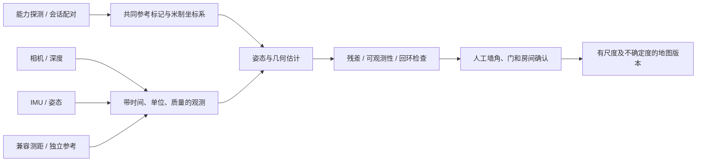

# 双设备协同室内测绘：可行性研究与实施边界

**未来模块，当前不存在实现。** 研究日期2026-10-21；不自动采购硬件、不提交代码、不假设只有无线信号就能准确出图。

## 结论与推荐起点

先做“设备A作为已知参考/质量监测端，设备B作为移动视觉惯性测绘端”，通过已知尺寸视觉标记建立共同坐标系，B采集人工确认的墙角/墙面；A协助重复定位、核验闭环，兼容时增加peer ranging。另一可选方案是两台移动设备分区扫描，但必须有共同标记或可验证的共同地图对齐，不能直接叠加两条独立轨迹。

两台设备仅有一个距离 `r` 时，二维位置通常位于一个圆上（还要处理高度差），无法单独确定方位，更不包含墙体轮廓。两台同时移动时还存在共同坐标系、尺度/方向、对称与漂移问题。加入可用方位或视觉姿态能增加约束，仍不自动观测墙。先检查观测是否充分，再解算；不得用“看起来像户型图”的绘制结果代替测量。

## 技术选择及前置条件

|方式|可能贡献|前提与限制|本项目现状|
|---|---|---|---|
|BLE/Wi-Fi RSSI|粗粒度接近/区域与拓扑线索|受发射功率、朝向、遮挡、多径影响，不能独立恢复墙体|BLE区域启发式已存在；Wi-Fi为AP巡检/传输|
|Wi-Fi RTT / FTM|到兼容AP或特定Aware peer的距离约束|硬件/角色/权限支持；AP多边定位需已知锚点位置和足够独立几何；不能默认普通两手机均是responder|未接入|
|UWB|兼容peer之间的距离，部分设备可能提供方向能力|双方能力、OOB会话参数、权限、外参和NLOS误差都需检查；不能把厂商理想指标当现场误差|未接入|
|Bluetooth Channel Sounding|兼容硬件的测距研究路线|并非现有BLE广播RSSI；需支持的芯片、系统/API和peer角色|未接入|
|相机+IMU / VIO / SLAM|移动相机姿态、局部地图与回环线索|低纹理/暗厅/玻璃/重复座椅/快速运动会丢跟踪，须重新定位和测量尺度|未接入|
|ARCore Depth / 可用ToF|局部表面距离与几何点|设备支持与逐帧质量限制；软件深度也依赖运动/纹理，不能假定所有手机有深度传感器|未接入|
|IMU / 步行航位推算|短时姿态、运动连续性和步行约束|加速度双积分漂移；磁场受钢结构干扰，不能当长时绝对位置|未接入|
|激光/卷尺/已知标记|尺度与墙长的独立参考|单射线激光距离必须结合方向/姿态；蓝牙数据接口及安装外参需核验|未接入|

Android16的统一Ranging接口涵盖多种技术，但API可用不意味着手机具备所有测距硬件。当前工程compileSdk35；若研究该新接口，应在单独评审中升级编译SDK并保持旧设备能力门控/回退，不承诺所有Android10手机均可精密测距。[Android Ranging](https://developer.android.com/develop/connectivity/ranging)。

Wi-Fi RTT与UWB必须依据官方能力、角色、权限和会话配置进行探测；当前局域网TCP往返时间不是这两类无线测距。[Wi-Fi RTT](https://developer.android.com/develop/connectivity/wifi/wifi-rtt)、[UWB](https://developer.android.com/develop/connectivity/uwb)。

ARCore结合视觉特征与惯性信息跟踪，Depth可结合运动和可用深度硬件。室内暗场及大空间应单独验证，不搬用文档中的通用性能数字作为影院保证。[ARCore fundamentals](https://developers.google.com/ar/develop/fundamentals)、[Depth](https://developers.google.com/ar/develop/depth)、[Android motion sensors](https://developer.android.com/develop/sensors-and-location/sensors/sensors_motion)。

## 建议模块与数据

候选接口：CapabilityProvider、PoseSource、RangeSource、FrameAligner、GeometryEstimator、QualityGate、MapRepository。观测包括monoTime、接收时刻、frameId、量纲、协方差、质量/失效原因、数据来源与软件/标定版本。相机、IMU和无线天线的外参/时间偏移不能忽略。

共同标记须有已知尺寸、姿态与可复查的frame变换；只用静态二维码传一个字符串不会自动建立几何姿态。视觉标记检测库、AR服务依赖及地图文件许可需要单独审查。云锚点不是第一版必选项，使用时需另审网络、隐私与费用；局部VIO也可能依赖已安装的AR服务，不能宣传所有设备完全无外部依赖。

估计器可以从带置信门槛的VIO+人工测量开始，再研究鲁棒因子图：视觉重投影、IMU预积分、peer range、已知标记和人工尺度等不同约束带独立噪声模型。NLOS偏差、重复纹理错闭环和动态行人须有拒绝机制。人体/设备轨迹不等于房间边界；需要观察或人工指出墙面、墙角与开口。

## 三阶段实验与退出条件

**A：共同坐标系与尺度。** 两台指定型号设备在明亮小房间观察同一已知标记，记录可重复的共享框架与已知长度；验证重启/重定位。没有共同frame或尺度不一致即停止，不自动画闭合房间。

**B：辅助绘图。** B沿墙采集人工确认点；提供捕获、撤销、复测、追踪丢失暂停和恢复。先输出“草图/待核验”，再比较卷尺/激光的边长、角点、面积与闭环误差。无线测距只是可选辅助约束。

**C：影院复杂场景。** 测试暗厅、长通道、重复座椅、镜面玻璃、不同高度/楼层、人员遮挡、两设备相互不可见、断网、功耗和热降频。独立建立参考图，按整场/设备拆分验证。报告维度误差分布、角点误差、回环漂移、共享frame对齐误差、完整性和失败率；先冻结验收门槛再采集，不在本报告填入承诺精度。

失败必须保留明确原因并允许回到当前手工编辑器；不要跨丢失区间硬接墙线。输出单位/尺度、参考frame、来源、质量区间、版本与人工修订记录。导出格式可先采用版本化JSON和SVG，CAD兼容另行规划；当前没有DXF/CDR测绘导出能力。

## 隐私与公开数据

相机帧可能包含顾客、票务屏幕和内部设备；默认为经授权的空场验证，尽量只存必要几何，不默认保留/上传原视频。公开示例使用合成房间或取得许可的脱敏场景，清理位置与业务文本，提供可验证删除和留存策略。测绘不能顺势扩展为对不知情顾客的身份追踪。
