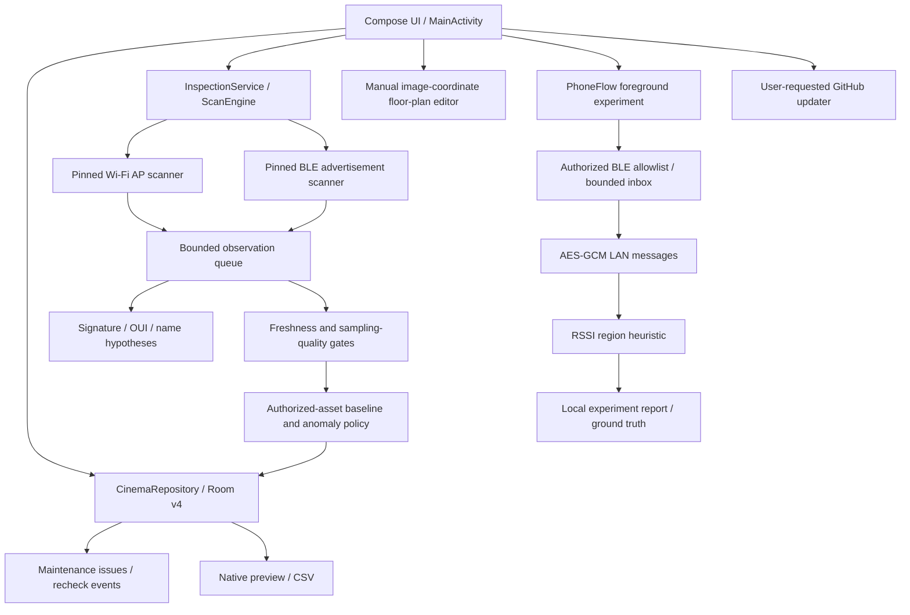

# Architecture — current implementation and proposed boundaries

**Draft for review, not applied.** Snapshot `208da9b98e884c831f25ece0221515a84b9d9654`, 2026-10-21. “Proposed” components below do not exist in the current product.

## Current modules and runtime paths

`app` owns product behavior and storage. `fieldwatch-core` retains pinned domain/radio source, parsing tests and lookup assets. `prototype` is outside Gradle source sets. Embedded geographic/export/LLM-prompt utilities do not mean those workflows are exposed. Source inventory and manifest checks provide a reproducible boundary, not a standalone SDK contract.

## Inspection

1. User selects a zone and mode; foreground service handles notification and bounded wake lock. No simultaneous product inspection and phone-flow experiment through normal UI/service entry points.
2. Wi-Fi uses scan callbacks with quota/backoff; adapter checks hardware scan timestamps. BLE emits advertisements. Unknown identifiers can be present transiently in RAM.
3. A512-entry observation channel, bounded live map and per-session dedup feed authorized asset samples and aggregate counts. Product classification uses pinned signatures/OUI plus conservative domestic ecosystem rules.
4. Only completed healthy sessions can escalate absence. Asset samples currently combine bindings; one baseline is stored per asset. Proposed refinement: radio-specific baselines with asset-level rollup.
5. Room persists authorized asset metadata, aggregate sessions/groups, asset results, confirmed baselines and maintenance events. Photos and plans are app-private files. CSV import restores aggregates only.

Evidence: [app/src/main/java/com/cinemawatch/radio/ScanEngine.kt:148](https://github.com/hoylturtle/CinemaWatch/blob/208da9b98e884c831f25ece0221515a84b9d9654/app/src/main/java/com/cinemawatch/radio/ScanEngine.kt#L148); [app/src/main/java/com/cinemawatch/domain/InspectionPolicy.kt:14](https://github.com/hoylturtle/CinemaWatch/blob/208da9b98e884c831f25ece0221515a84b9d9654/app/src/main/java/com/cinemawatch/domain/InspectionPolicy.kt#L14); [app/src/main/java/com/cinemawatch/data/Database.kt:90](https://github.com/hoylturtle/CinemaWatch/blob/208da9b98e884c831f25ece0221515a84b9d9654/app/src/main/java/com/cinemawatch/data/Database.kt#L90).

## Phone-flow experiment

The coordinator distributes session-scoped authorized tag IDs and bindings through authenticated encryption. Collectors only queue authorized lightweight readings; timestamps derive from Fieldwatch callback receipt. LAN push uses bounded length frames, per-node sequence checks and clock-offset estimates. Shared-key possession authorizes participation but does not establish an individually attested node identity.

FlowTracker applies six-second medians, minimum samples, distinct-zone evidence, manual offsets, a6dB lead and two consecutive evaluations. Same-zone nodes use the strongest median. Unknown evidence clears continuity. Dwell sums tag seconds; it is not people-time. It outputs zone IDs, margin and evidence counts, not calibrated probabilities or coordinate uncertainty.

Limits: fifteen-minute experiment; sixteen nodes/tags; at most100 configured areas; ten-second heartbeat eligibility; collector stops after thirty seconds disconnected. Compact collector snapshots truncate signal/transition/truth arrays; the coordinator report keeps the fuller bounded history. The normal loop interval also includes network and restart delays.

Evidence: [app/src/main/java/com/cinemawatch/flow/PhoneFlow.kt:63](https://github.com/hoylturtle/CinemaWatch/blob/208da9b98e884c831f25ece0221515a84b9d9654/app/src/main/java/com/cinemawatch/flow/PhoneFlow.kt#L63); [app/src/main/java/com/cinemawatch/flow/FlowTracker.kt:43](https://github.com/hoylturtle/CinemaWatch/blob/208da9b98e884c831f25ece0221515a84b9d9654/app/src/main/java/com/cinemawatch/flow/FlowTracker.kt#L43); [app/src/main/java/com/cinemawatch/flow/FlowTransport.kt:18](https://github.com/hoylturtle/CinemaWatch/blob/208da9b98e884c831f25ece0221515a84b9d9654/app/src/main/java/com/cinemawatch/flow/FlowTransport.kt#L18).

## Data boundaries

|Data|Current location|Sharing boundary|
|---|---|---|
|Unregistered observations|Bounded session RAM|Not a normal persisted/exported projection|
|Authorized radio bindings|Private Room database|Session whitelist sent to participating collectors through encryption|
|Inspection/group summaries|Room and user-requested CSV|User controls share/export; names/notes can be sensitive|
|Maintenance photos|Private files plus camera/cache intermediates|User camera/photo selection; reset currently incomplete|
|Floor-plan image and pins|Private files, normalized image coordinates|Manual geometry; no inferred metric coordinate frame|
|Pilot key|Memory and explicit user clipboard copy|Valid for current bounded experiment; do not publish|
|Pilot report|Private JSON; optional export|No automatic raw-address/key fields; labels/route text still need review|

## Update and release path

User-requested HTTPS GitHub discovery/download has URL, size, digest, package, version and installed-certificate checks, then system confirmation. CI verifies debug candidates and re-signs them using persistent Actions secrets; the observed APK is still debuggable. Proposed release-variant hardening must preserve signature continuity and add post-minification tests.

## Proposed maintainability boundaries

Introduce testable interfaces for monotonic clocks, scanner events, session coordination, transport, observation quality and region inference. Separate feature state from Compose rendering, and file retention from Room transactions. Publish schema/export versions and clear shutdown/cancellation ownership. Keep upstream source unchanged unless an explicit pin review approves changes.

A future `mapping` feature should consume typed visual/depth/inertial/range observations with units and covariance, maintain a shared metric frame and preserve unknown/unobservable states. No mapping implementation is present today; see DUAL_DEVICE_MAPPING_RESEARCH.md. Avoid equating a manually assigned zone, a radio category, and a geometric pose.
